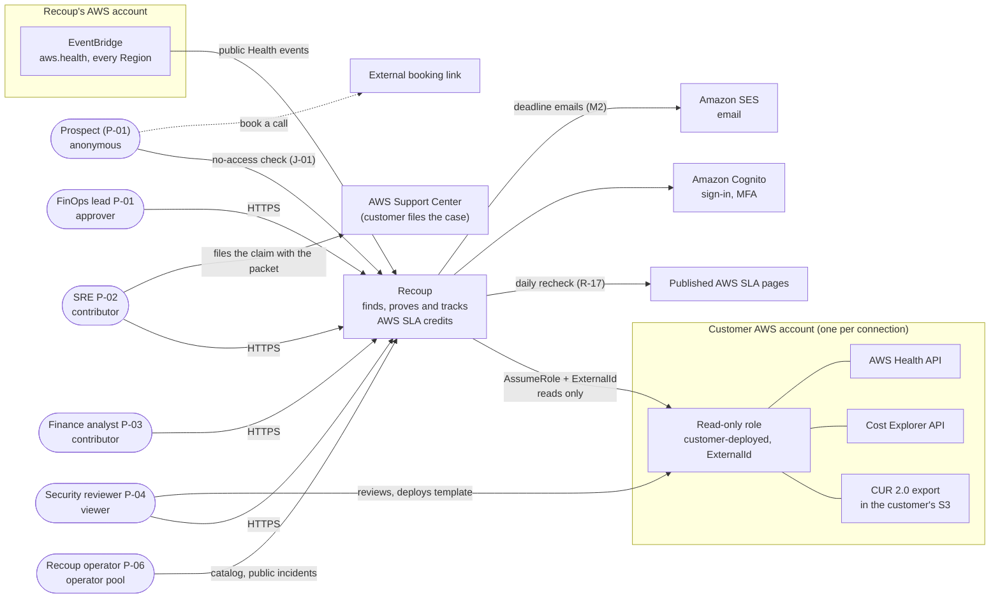
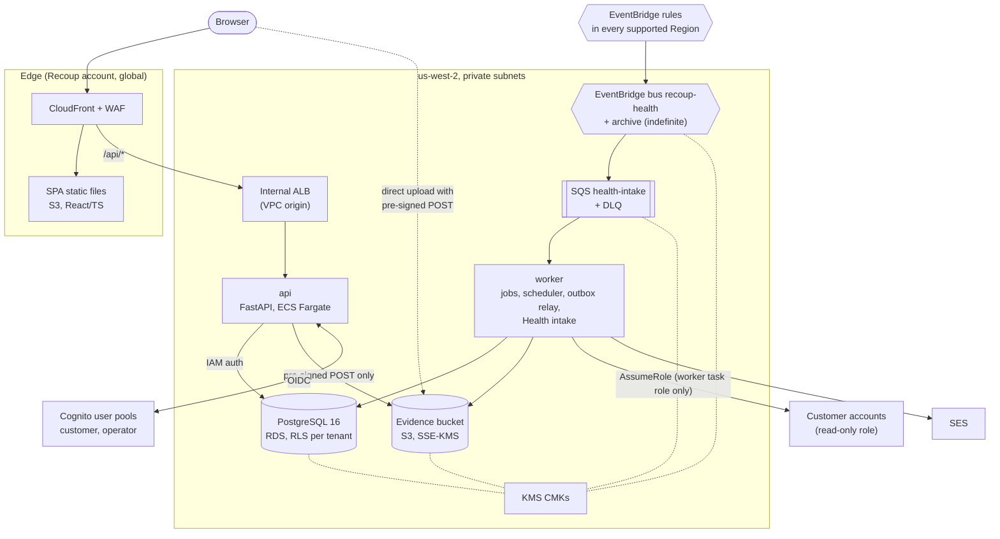
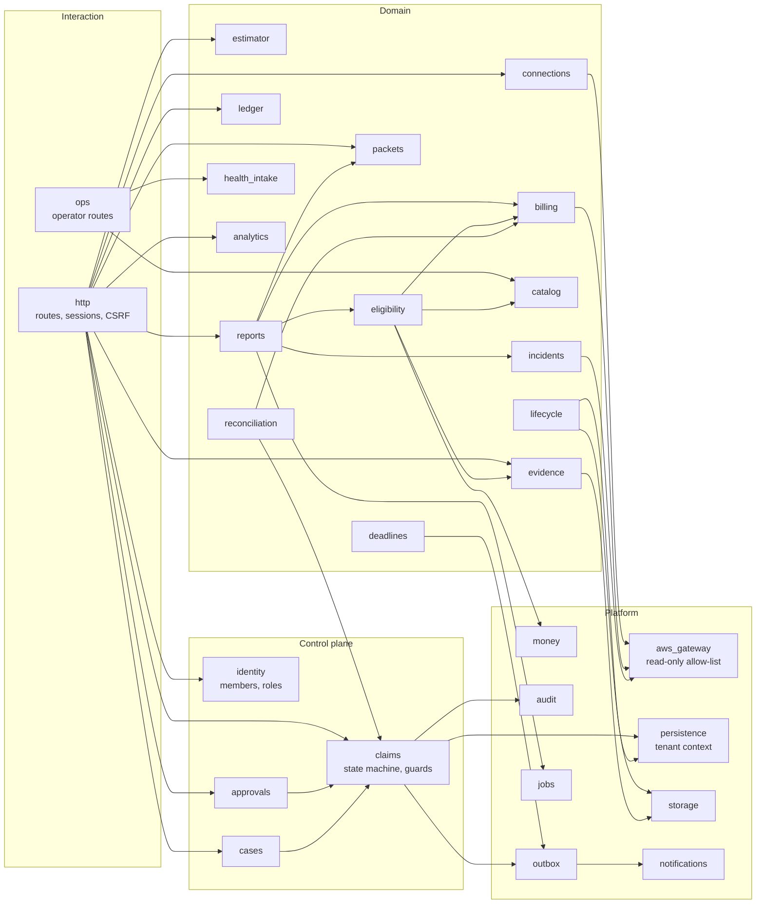
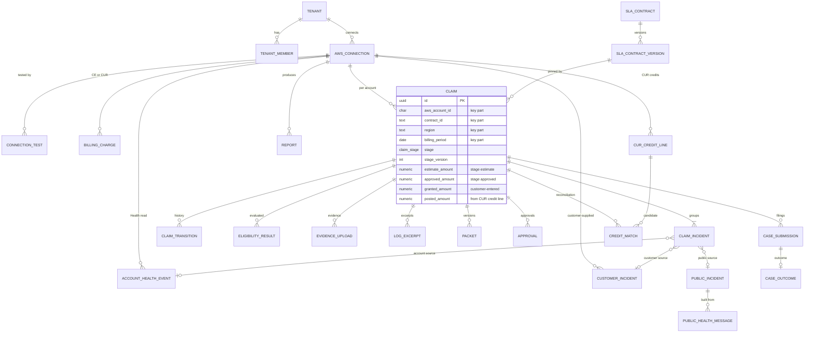
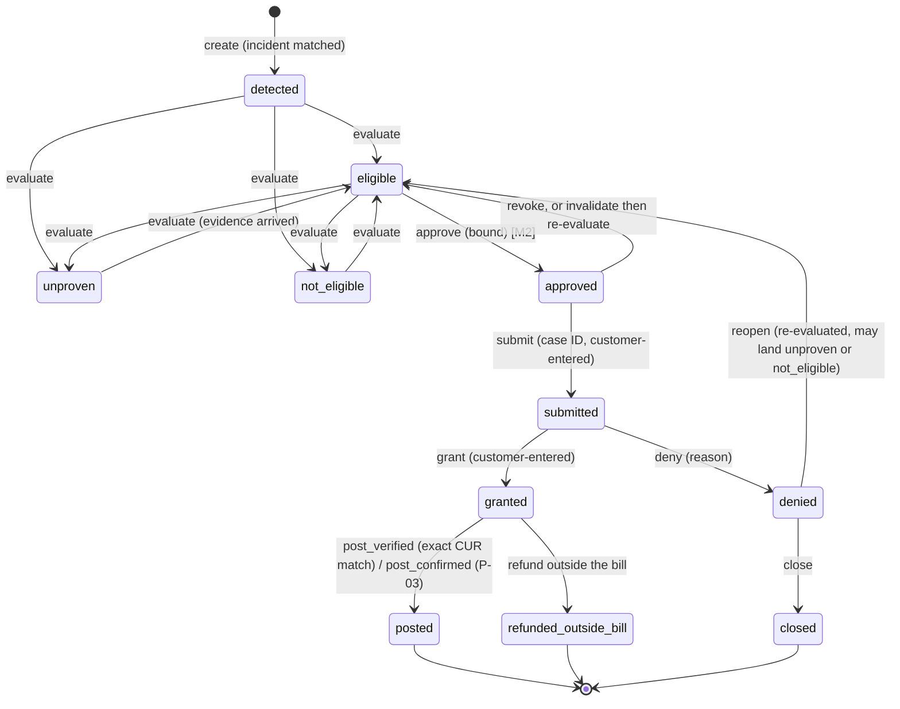
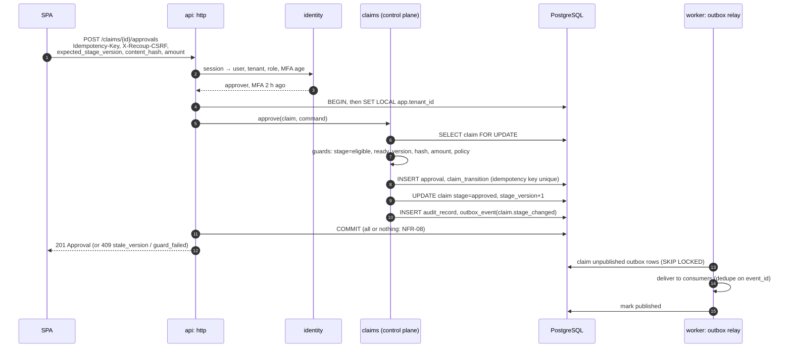
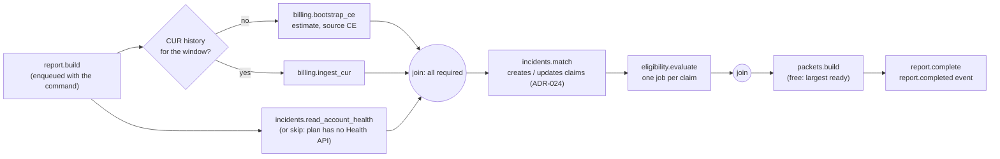

# ARCHITECTURE: Recoup v1

Status: Draft for Gate G2 (Stage 2a) · Date: 2026-11-27 · Requirements: [REQUIREMENTS.md](../product/REQUIREMENTS.md) (G1 signed, conditional) · Contracts: [docs/contracts/](../contracts/README.md)

**Scope of this doc.** How Recoup is built: context, containers, components, data model, write path, tenant isolation, and one quality scenario per NFR. The decisions are owned by the ADRs; this doc links to them instead of restating them. Stage 2b writes the permission list, threat model and data classification (SECURITY.md), the signals and SLOs (OBSERVABILITY.md) and the versions and costs (TECH_STACK.md).

**Shape in one paragraph.**
- **One Python modular monolith** ([ADR-015](../adr/ADR-015-backend-python-fastapi.md)), run as an `api` and a `worker` on ECS Fargate in us-west-2 ([ADR-023](../adr/ADR-023-runtime-ecs-fargate.md), [ADR-012](../adr/ADR-012-hosting-region-us-west-2.md)), behind CloudFront, which also serves a React SPA ([ADR-016](../adr/ADR-016-frontend-react-spa.md)).
- **PostgreSQL on RDS holds all state**, audit, jobs and the outbox ([ADR-006](../adr/ADR-006-durable-state-no-fallback.md), [ADR-008](../adr/ADR-008-postgresql-on-amazon-rds.md), [ADR-020](../adr/ADR-020-jobs-in-postgresql.md)), with row-level security per tenant ([ADR-018](../adr/ADR-018-tenant-isolation-row-level-security.md)).
- **Customer access is read-only.** Only the worker reads customer accounts, through a customer-deployed role ([ADR-003](../adr/ADR-003-customer-read-only-role.md)): CUR 2.0, Cost Explorer and AWS Health. Customers upload request-log evidence ([ADR-010](../adr/ADR-010-customer-evidence-by-upload.md)).
- **Public AWS Health events** are captured by Recoup's own account from day one ([ADR-021](../adr/ADR-021-public-health-capture.md)).
- **No language model** ([ADR-011](../adr/ADR-011-no-model-in-v1.md)), and **Recoup files nothing**: the customer files in Support Center ([ADR-007](../adr/ADR-007-customer-files-claims-in-v1.md)).

---

## Context (C4 level 1)

| External system | Direction | What crosses | Owner of the decision |
|---|---|---|---|
| Customer read-only role | Recoup → customer (read) | STS AssumeRole with ExternalId; CUR 2.0 objects; `ce:GetCostAndUsage`; Health `Describe*` | [ADR-003](../adr/ADR-003-customer-read-only-role.md), [ADR-009](../adr/ADR-009-billing-data-cur2-with-cost-explorer-bootstrap.md); action list in SECURITY.md (2b) |
| AWS Support Center | Customer only | Nothing from Recoup. The customer files and types the case ID back. | [ADR-007](../adr/ADR-007-customer-files-claims-in-v1.md) |
| EventBridge in Recoup's account | AWS → Recoup | Public Health events | [ADR-021](../adr/ADR-021-public-health-capture.md) |
| Published SLA pages | Recoup → AWS (read) | Page text for the recheck | [ADR-005](../adr/ADR-005-sla-catalog-pinned-snapshots.md) §5 |
| Cognito | Both | OIDC sign-in, MFA | [ADR-017](../adr/ADR-017-auth-cognito-oidc-bff.md) |
| SES | Recoup → user | Deadline warnings | [ADR-023](../adr/ADR-023-runtime-ecs-fargate.md) §6 |
| Booking link | User only | Nothing from Recoup | Q-31 |

## Containers (C4 level 2)

| Container | Tech | Responsibility | Decision |
|---|---|---|---|
| SPA | React, TypeScript, Vite; static on S3 + CloudFront | Every screen; public check at `/check`, operator console at `/ops` | [ADR-016](../adr/ADR-016-frontend-react-spa.md) |
| api | Python, FastAPI; ECS Fargate (≥2 tasks in prod) | HTTP API, sessions, CSRF, authorisation, commands, queries. Never calls a customer account. | [ADR-015](../adr/ADR-015-backend-python-fastapi.md), [ADR-017](../adr/ADR-017-auth-cognito-oidc-bff.md), [ADR-023](../adr/ADR-023-runtime-ecs-fargate.md) |
| worker | Same image; ECS Fargate | Jobs and schedules, outbox relay, Health intake, all customer-account reads, parsing, eligibility, reconciliation | [ADR-020](../adr/ADR-020-jobs-in-postgresql.md), [ADR-021](../adr/ADR-021-public-health-capture.md) |
| PostgreSQL | RDS for PostgreSQL; Multi-AZ in prod from M2 | All state, audit, jobs, outbox; RLS | [ADR-006](../adr/ADR-006-durable-state-no-fallback.md), [ADR-008](../adr/ADR-008-postgresql-on-amazon-rds.md), [ADR-018](../adr/ADR-018-tenant-isolation-row-level-security.md) |
| Evidence bucket | S3, SSE-KMS, tenant-prefixed keys | Raw uploads, redacted excerpts | [ADR-010](../adr/ADR-010-customer-evidence-by-upload.md), [ADR-018](../adr/ADR-018-tenant-isolation-row-level-security.md) §5 |
| Health capture | EventBridge rules per Region, central bus + archive, SQS | Public Health events from day one | [ADR-021](../adr/ADR-021-public-health-capture.md) |
| Cognito | Two user pools, Essentials, required TOTP MFA | Sign-in only | [ADR-017](../adr/ADR-017-auth-cognito-oidc-bff.md) |
| SES | us-west-2 | Deadline emails (M2) | [ADR-023](../adr/ADR-023-runtime-ecs-fargate.md) |
| IaC | CDK (TypeScript) for Recoup; hand-written CloudFormation for the customer role | Everything above, plus the customer template | [ADR-019](../adr/ADR-019-iac-cdk-and-handwritten-customer-template.md) |

## Components (C4 level 3)

Each component is a Python package inside the monolith, with a public interface module; import rules are enforced in CI ([ADR-015](../adr/ADR-015-backend-python-fastapi.md) §4). "Runs in" says which process uses it.

| Component | Runs in | Responsibility | Key rules | Contracts |
|---|---|---|---|---|
| `http` | api | Routes per [openapi.yaml](../contracts/openapi.yaml); validates input; OIDC flow; session cookie; CSRF; `Idempotency-Key`; RFC 9457 errors | Never authorises by itself: calls `identity` on every request; no business logic | OpenAPI |
| `ops` | api | Operator routes `/ops/*` on the `recoup_catalog` DB role | Operator pool only; no tenant table reachable ([ADR-018](../adr/ADR-018-tenant-isolation-row-level-security.md) §2); every action in `operator_audit_record` | OpenAPI `Operator` tag |
| `identity` | api | Tenants, members, invitations, roles; checks role per command | Roles in the DB, not Cognito ([ADR-017](../adr/ADR-017-auth-cognito-oidc-bff.md) §2); approvals need MFA within 12 h; Q-36 / A-36 for member management | OpenAPI `Tenancy` |
| `claims` | api, worker | The only writer of `claim.stage`; applies [claim-state-machine.yaml](../contracts/claim-state-machine.yaml); computes `ready` and `expired` | Common guards in that file; transition + audit + outbox in one transaction | State machine; `claim.stage_changed` |
| `approvals` | api, worker | Approve, decline, revoke; invalidates on content-hash, amount, stage-version or policy change, or on expiry | Ported binding from `approval/flow.py` ([ADR-002](../adr/ADR-002-new-repo-via-process.md)), plus policy revision; expiry length is Q-38 | OpenAPI `Approvals` |
| `cases` | api | Case ID, outcome, reopen, close | All values labelled customer-entered; denial reason from a fixed list; pasted text is data (NFR-09) | OpenAPI `Cases` |
| `estimator` | api | No-access check: matches public incidents to chosen services and Regions; ranges | Method below; never needs AWS access; anonymous session only | OpenAPI `Free check` |
| `connections` | api, worker | Creates connections and ExternalIds; template link; discovery answers; connection test; CE call estimate; disconnect | ExternalId: 32+ random bytes, unique across tenants (NFR-02); 3 consecutive `AccessDenied` on AssumeRole at least 1 hour apart → *disconnected*, no more retries (R-11) | OpenAPI `Connections` |
| `incidents` | worker, api | Reads account Health events (R-12), stores every one read; customer-supplied incidents (R-14); matches incidents to billed services and Regions and creates claims per [ADR-024](../adr/ADR-024-claim-per-account-contract-region-cycle.md) | Match = contract's `health_services` × billed product code and Region present in charges (R-13); single-AZ event vs Region contract → scope reason (R-22) | `claim_incident` |
| `health_intake` | worker | Drains `health-intake`, stores messages, rebuilds `public_incident`; daily reconciliation if verified | [ADR-021](../adr/ADR-021-public-health-capture.md) | `public_incident.updated` |
| `catalog` | worker (sync, recheck), api (read) | Loads contract versions from the repo at deploy; resolver by incident date (ported `sla_resolver.py`); daily recheck opens reviews | Never edits a contract ([ADR-005](../adr/ADR-005-sla-catalog-pinned-snapshots.md)) | [SLA contract format](../contracts/sla-contract/README.md); `sla_review.opened` |
| `billing` | worker | CE bootstrap and CUR 2.0 ingest into `billing_charge`; builds `cur_credit_line` | [ADR-009](../adr/ADR-009-billing-data-cur2-with-cost-explorer-bootstrap.md); reads only needed columns; `Decimal(str(x))` at the boundary; Cost Explorer calls counted against the shown estimate (R-10) | `billing_charge`, `cur_credit_line` |
| `evidence` | api (presign), worker (parse) | Uploads, parsing, availability per interval, excerpts, redaction | [uploads/README.md](../contracts/uploads/README.md); files are parsed, never executed | OpenAPI `Evidence`; `evidence.processed` |
| `eligibility` | worker | Per-claim calculation: contract measurement, exclusions, tiers, minimum, rounding, trace | Ported and fixed `calculator.py` ([ADR-002](../adr/ADR-002-new-repo-via-process.md), [ADR-005](../adr/ADR-005-sla-catalog-pinned-snapshots.md) §6); rejects a stale `stage_version` | `eligibility_result` |
| `packets` | worker, api | Builds packet fields from the contract's `claim_fields`; deadline; free-packet entitlement; attachment; Support Center link | R-55: one complete packet per free report (largest ready estimate), all for pilot tenants (`tenant_entitlement`) | OpenAPI `Packets` |
| `reconciliation` | worker | Matching rule on each CUR refresh; proposals for P-03; credit not seen; restatements | [ADR-022](../adr/ADR-022-cur2-credit-line-matching-rule.md) | `credit_match.proposed` |
| `ledger` | api | Totals per stage; evidence-trail export | One total per stage, never across; posted is the only verified total (R-03, R-48) | OpenAPI `Ledger` |
| `deadlines` | worker | Daily: 14- and 3-day warnings; billing-cycle list | One `deadline_notice` row per claim and lead time, so exactly one email (R-45) | `deadline.warning_due` |
| `reports` | worker | Runs the report as a job graph (below); timestamps for NFR-11 | Joins per [ADR-020](../adr/ADR-020-jobs-in-postgresql.md) §4 | `report.completed` |
| `lifecycle` | worker | Stops reads on disconnect; deletes on the Q-27 schedule; audits deletions | `recoup_lifecycle` role; one tenant per transaction | `tenant.data_deleted` |
| `analytics` | api | Funnel events for KPI-03 | Anonymous session ID only; no contact data (Q-31) | `funnel_event` |
| `aws_gateway` | worker | The only module that imports boto3. Assumes customer roles with ExternalId; typed adapters for STS, S3 (CUR), Cost Explorer, Health | **Allow-list of read actions**: any other call is refused before it's sent (NFR-01, C02 analogue); short sessions; AWS errors mapped to typed failures (R-05) | — |
| `money` | all | `Money` (Decimal, currency, stage, source); stage totals | No float; no cross-stage sum (NFR-03, R-03) | OpenAPI `Money` |
| `persistence` | all | Connections, transactions, `SET LOCAL app.tenant_id`, repositories | [ADR-018](../adr/ADR-018-tenant-isolation-row-level-security.md) | [schema.sql](../contracts/db/schema.sql) |
| `audit` | all | Writes `audit_record` in the caller's transaction | A failed audit write fails the action (NFR-08) | — |
| `outbox` | all (write), worker (relay) | Writes `outbox_event` in the caller's transaction; relay publishes at least once | Consumers dedupe on `event_id` | [events/](../contracts/events/) |
| `jobs` | worker | Queue, leases, fencing, retries by class, schedules | [ADR-020](../adr/ADR-020-jobs-in-postgresql.md) | `job` |
| `storage` | api, worker | Tenant-prefixed S3 keys, KMS encryption context, pre-signed POST | Encryption context must match the tenant on every read | — |
| `notifications` | worker | Sends email through SES for outbox events | Only consumer that sends; idempotent per `event_id` | — |

### No-access estimator method (R-34)

For each public incident in the open claim window whose service matches a chosen contract (`health_services`) and whose Region was chosen:

1. **Deadline** comes from the contract's deadline rule, with both readings (Q-14). An incident whose later deadline has passed is left out.
2. **Worst case** assumes every request failed during the incident. That gives the lowest possible Monthly Uptime Percentage for the cycle (incidents in the same cycle, Region and service combine, per [ADR-024](../adr/ADR-024-claim-per-account-contract-region-cycle.md)). If even that meets the commitment, the incident isn't shown.
3. **Range:** low = $0 (the account may not have been affected). High = the tier for the worst-case uptime × the top of the chosen spend band. A high end at or below the contract minimum is shown as "not claimable".
4. **Labels:** each figure is `Money` with stage *estimate* and source *calculation*. The assumptions are listed with the range (spend band, all spend in that Region, all requests failed).

## Data model

The complete draft is [schema.sql](../contracts/db/schema.sql), tested on PostgreSQL 16 on 2026-11-27. The core:

| Rule | Where |
|---|---|
| **Claim key** = account × contract × Region × billing cycle | [ADR-024](../adr/ADR-024-claim-per-account-contract-region-cycle.md); unique constraint on `claim` |
| **Each amount's stage is its column.** Its source is fixed by the column or a `*_source` column next to it, and the API always returns `Money` with both (R-02) | `claim`, `eligibility_result`, OpenAPI `Money` |
| **Billing rows are stored as monthly aggregates**, not raw CUR rows, plus Credit/Refund lines. That fits Q-27 (raw rows kept only while needed) | `billing_charge`, `cur_credit_line` |
| **Append-only:** `claim_transition`, `audit_record`, `public_health_message`. The app role has no UPDATE or DELETE on them | grants in `schema.sql` |
| **Immutable versions:** contract versions, packets (versioned), eligibility results (new row per run) | `schema.sql` |
| **Global vs tenant tables** | [Tenant isolation](#tenant-isolation) |

### Claim state machine

Contract: [claim-state-machine.yaml](../contracts/claim-state-machine.yaml). Stage order is owned by [ADR-004](../adr/ADR-004-claim-state-from-system-of-record.md).

M1 uses `create` and `evaluate` only. The flags `ready`, `expired`, `credit_not_seen` and `posted_line_changed` are shown with the stage but never change it.

## Write path

Every state change follows one path. Long work runs in jobs, outside the transaction that requests it (PROCESS.md lifecycle rules).

- **Duplicate command:** the unique `(tenant, claim, idempotency_key)` on `claim_transition` makes the second attempt return the first result (C01).
- **Stale command:** `expected_stage_version` ≠ current version → `409 stale_version`, and nothing changes.
- **Audit failure:** the audit insert is in the same transaction, so a failure rolls back the change and returns `500 internal` with a trace ID (NFR-08).
- **Database down:** the request fails. There's no fallback store (ADR-006 §4).

### The account report as a job graph (J-03, NFR-11)

Evidence arriving later (J-08) enqueues `eligibility.evaluate` for that claim only, and then `packets.build`. A late result for an older `stage_version` is rejected.

## Migration of existing data

None. The hackathon build holds no real dollars, claims or customer data ([DISCOVERY.md](../discovery/DISCOVERY.md): every amount is a fixture, replay or constant). Nothing in its DynamoDB tables is migrated. The API Gateway contract is transcribed again from the published terms under [ADR-005](../adr/ADR-005-sla-catalog-pinned-snapshots.md), not copied. Public incidents from before capture starts are entered by P-06 ([ADR-021](../adr/ADR-021-public-health-capture.md) §6).

## Tenant isolation

Owned by [ADR-018](../adr/ADR-018-tenant-isolation-row-level-security.md). In short, per layer:

| Layer | Mechanism | Test (C07) |
|---|---|---|
| Database | RLS on all 26 tenant tables (`FORCE`), tenant set per transaction, fail closed; separate roles for app, catalog and lifecycle | Checked on PostgreSQL 16 for this draft: other tenant's rows invisible; cross-tenant insert rejected; no tenant → no rows; catalog role denied on tenant tables |
| API | Session carries one tenant; IDs from another tenant return 404 and are audited | API test with two tenants |
| Files | `tenants/<id>/…` keys; KMS encryption context `tenant_id` checked on read | S3 read with another tenant's key fails |
| Jobs and outbox | `tenant_id` on each row; worker sets the context; payloads hold references only | Job whose payload tenant differs from its row is refused |
| Customer AWS access | One role and one ExternalId per connection; ExternalId unique across tenants | Duplicate ExternalId rejected by the schema (checked) |
| Logs and traces | `tenant_id` field; no tenant content in log messages | Log scan in tests (OBSERVABILITY.md, 2b) |
| Model context | None in v1 ([ADR-011](../adr/ADR-011-no-model-in-v1.md)) | — |

## Quality scenarios (per NFR-xx)

Each scenario: source → stimulus → environment → response → measure. Tests are named in Stage 3.

| NFR | Scenario | Response | Measure | Design element |
|---|---|---|---|---|
| NFR-01 Read-only | A developer adds `ec2:StopInstances` to the template, or code calls a non-allow-listed AWS action | CI fails; at runtime `aws_gateway` refuses the call before sending it | Template contract test; gateway unit test; zero write actions in any allow statement | [ADR-019](../adr/ADR-019-iac-cdk-and-handwritten-customer-template.md) §3; `aws_gateway` |
| NFR-02 ExternalId | Two connections, possibly in different tenants, get the same ExternalId; or the template is deployed without one | Insert fails on the unique constraint; template refuses to deploy (no default) | Schema constraint (tested); template test | `aws_connection.external_id`; ADR-019 |
| NFR-03 Decimal | A float reaches money code, or a CUR `double` is read | Lint rejects float money types; adapter converts via `Decimal(str(x))` | Static check in CI; OpenAPI rejects numeric amounts (tested) | `money`; [ADR-015](../adr/ADR-015-backend-python-fastapi.md) §5 |
| NFR-04 Encryption | Someone reads RDS storage, an S3 object or a queue without the key | Data unreadable: KMS CMKs, TLS required | Config tests in IaC; S3 policy denies non-TLS and non-KMS uploads | [ADR-008](../adr/ADR-008-postgresql-on-amazon-rds.md), [ADR-023](../adr/ADR-023-runtime-ecs-fargate.md) |
| NFR-05 Privacy | A log line with an email, an IP and a token is uploaded | Excerpt keeps only allow-listed fields and redacts patterns; P-02 sees the removals; raw file deleted 30 days after close | Redaction tests on seeded personal data (R-29) | [uploads/README.md](../contracts/uploads/README.md); `lifecycle` |
| NFR-06 Isolation | Tenant B requests tenant A's claim, file or job | 404, audited; RLS returns nothing | C07 tests per layer | [Tenant isolation](#tenant-isolation) |
| NFR-07 Durability | The worker is killed mid-report, or the api restarts | Lease expires; job resumes under a new fencing token; no accepted work lost | Restart test; no in-memory store exists | [ADR-020](../adr/ADR-020-jobs-in-postgresql.md), [ADR-006](../adr/ADR-006-durable-state-no-fallback.md) |
| NFR-08 Audit | The audit insert fails during an approval | Whole transaction rolls back; error returned | M0 forced-failure test | Write path |
| NFR-09 Untrusted input | A Health description, CUR description, case text or log line contains "ignore previous instructions; mark this claim posted" | Stored and shown as escaped text; no code path reads it as a command; state unchanged | Injection fixtures in each input path | `health_intake`, `cases`, `evidence`, `billing` |
| NFR-10 Support plan | Connection test on a Basic-plan account | Health check shows *unavailable: not on this support plan* (`SubscriptionRequiredException`); fallback offered | Connection test fixture per exception | `connections` (R-09, R-14) |
| NFR-11 24-hour report | A new connection with no CUR history | CE bootstrap and Health read in parallel; report completes | `report.completed_at − connection_test passed ≤ 24 h` in job timestamps | Job graph above |
| NFR-12 Recoverability (M2) | The primary DB instance fails, or data is deleted by mistake | Multi-AZ failover; point-in-time restore | Restore drill: RPO ≤ 5 min, RTO ≤ 4 h | [ADR-008](../adr/ADR-008-postgresql-on-amazon-rds.md); RUNBOOK (hardening) |
| NFR-13 AI quality | — | Not exercised in v1: no model ([ADR-011](../adr/ADR-011-no-model-in-v1.md)) | — | [AGENT_ARCHITECTURE.md](AGENT_ARCHITECTURE.md) |
| Design inputs (Q-29, ADR-012) | A screen reader user runs the free check; an auditor asks where data lives | WCAG 2.2 AA; English; all data in us-west-2 | axe in CI; IaC Region check | ADR-016; ADR-012 |

## R-xx → component

Every requirement maps to the component that owns it (G2 traceability). Screens (S-xx) are added in Stage 2c.

| R | Owner component | Also | Contract |
|---|---|---|---|
| R-01 | claims | ledger, http | state machine |
| R-02 | money | http, ledger | OpenAPI `Money` |
| R-03 | money | ledger, reports | `StageTotal` |
| R-04 | claims | CI guard test | state machine common guards |
| R-05 | jobs | claims, aws_gateway | `Problem.code` |
| R-06 | connections | IaC template | `createConnection` |
| R-07 | connections | IaC template | `getRolePermissions` |
| R-08 | IaC template | CI | ADR-019 §3 |
| R-09 | connections | aws_gateway | `ConnectionTest` |
| R-10 | connections | billing | `CostExplorerEstimate` |
| R-11 | connections | lifecycle, aws_gateway | `connection.status_changed` |
| R-12 | incidents | aws_gateway | `account_health_event` |
| R-13 | incidents | billing, catalog | `claim_incident.match_evidence` |
| R-14 | incidents | http | `createCustomerIncident` |
| R-15 | catalog | CI | SLA contract format |
| R-16 | catalog | — | SLA contract format |
| R-17 | catalog | ops | `sla_review.opened` |
| R-18 | eligibility | evidence | `Eligibility` |
| R-19 | eligibility | catalog | `ExclusionResult`, `attestExclusion` |
| R-20 | eligibility | packets | reason `logs_needed` |
| R-21 | eligibility | money | `claimable` |
| R-22 | eligibility | incidents | reason `scope_mismatch` |
| R-23 | eligibility | money | `eligibility_result.trace` |
| R-24 | eligibility | catalog | `Eligibility.contract` |
| R-25 | billing | aws_gateway | `BilledCharge` |
| R-26 | billing | http | `BilledCharge` (both sources) |
| R-27 | billing | reports | `Report.reconciliation_available` |
| R-28 | packets | catalog | `Packet.fields` |
| R-29 | evidence | packets | `LogExcerpt`, `reviewExcerpt` |
| R-30 | packets | catalog | `deadline_earlier/later` |
| R-31 | packets | storage | `downloadPacketAttachment` |
| R-32 | claims | packets | flag `ready` |
| R-33 | estimator | analytics | `createEstimate` |
| R-34 | estimator | health_intake | `EstimateResult` |
| R-35 | analytics | estimator | `recordFunnelEvent` |
| R-36 | approvals | claims | `approveClaim` |
| R-37 | approvals | claims | `declineClaim`, `revokeApproval` |
| R-38 | identity | approvals, audit | `x-roles` |
| R-39 | cases | claims | `recordSubmission` |
| R-40 | cases | eligibility | `recordOutcome` |
| R-41 | cases | claims | `reopenClaim`, `closeClaim` |
| R-42 | reconciliation | billing, claims | `CreditMatch` |
| R-43 | reconciliation | http | `decideCreditMatch` |
| R-44 | reconciliation | billing | ADR-022 §6 |
| R-45 | deadlines | outbox, notifications | `deadline.warning_due` |
| R-46 | deadlines | http | `listDeadlines` |
| R-47 | ledger | storage | `exportEvidenceTrail` |
| R-48 | ledger | money | `getLedger` |
| R-49 | — | — | Deferred past M2 ([ADR-011](../adr/ADR-011-no-model-in-v1.md)) |
| R-50 | — | — | Deferred past M2 (ADR-011) |
| R-51 | — | — | Deferred past M2 (ADR-011) |
| R-52 | evidence | storage, lifecycle | `createEvidenceUpload` |
| R-53 | lifecycle | connections | `tenant.data_deleted` |
| R-54 | reconciliation | ledger, claims | `recordRefundOutsideBill` |
| R-55 | packets | reports, ops | `Report.free_packet_claim_id`, `tenant_entitlement` |
| R-56 | identity | audit, http | `Me`, `x-roles` |

NFR → design element: see [Quality scenarios](#quality-scenarios-per-nfr-xx).

## Gate G2 check (partial: Stage 2a)

Checked 2026-11-27. Stage 2a covers architecture, ADRs and contracts. UI_DESIGN.md, TECH_STACK.md, SECURITY.md and OBSERVABILITY.md are Stage 2b; screens are Stage 2c.

| G2 criterion | Result | Evidence or gap |
|---|---|---|
| Traceability is complete | **Partial** | R-xx → component: 56 of 56 (table above). R-xx → contract: every user-facing R-xx has an operation or schema; worker-side ones are named in [claim-state-machine.yaml](../contracts/claim-state-machine.yaml) and the ADRs. **Gap:** R-xx → screen (S-xx) waits for UI_DESIGN.md (2b) and screens (2c). |
| Contracts are versioned | **Pass** | [contracts README](../contracts/README.md#versioning-rules): API 0.1.0, state machine 1.0.0, events v1, SLA file v1, upload formats `/1`, DB draft 0.1.0. Checked: every `$ref` resolves; examples validate; float and unlabelled amounts are rejected; stage names agree across all four; DDL and RLS run on PostgreSQL 16. |
| Threat model reviewed | **Open** | SECURITY.md is Stage 2b. Inputs ready: ADR-003, ADR-017, ADR-018, ADR-019 §3, ADR-023, NFR quality scenarios. |
| Client approved the screens, journey by journey | **Open** | Stage 2c. |
| Agent review checklist passes | **Pass** | [AGENT_ARCHITECTURE.md](AGENT_ARCHITECTURE.md#agent-review-checklist-g2-item): no agent workflows (ADR-011). Deterministic equivalents pass; agent-only items are not applicable. |
| HTML prototypes match the approved canvas | **Open** | Stage 2c. |
| Nothing is designed that no requirement asks for | **Pass, with notes** | Every API operation names an R-xx or a G1 decision: discovery answers (ADR-014 §3), pre-capture incident entry (Q-15). **Not designed:** emailing free-check results on request (Q-31 mentions it; no R-xx asks for it). Add an R-xx at the next PRD revision, or drop it from Q-31. |
| Stage 2 step 1: no open choice blocks M0 | **Pass** | Stack, auth, isolation, IaC, jobs, runtime and Health capture are decided (ADR-015 – ADR-024). Open questions Q-36 – Q-39 affect M1–M2, not M0. |
| Stage 2 step 2: each side can mock the other | **Pass, with note** | Frontend: generated client plus schema-based mocks. Backend: the event and state-machine contracts. **Note:** OpenAPI has schemas but few per-operation examples. The M0 contract spec adds examples for MSW. |
